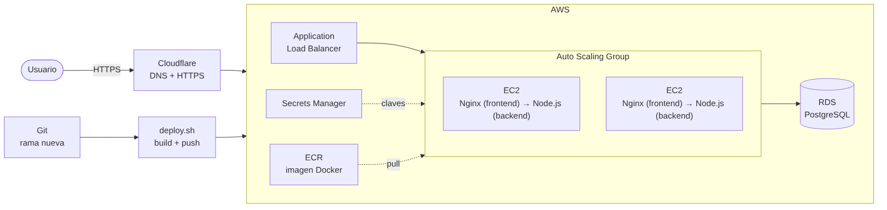

# 1. Objetivo y alcance

Este documento describe el **procedimiento de implementación** de la Carta Digital correspondiente a la **3ª entrega**: *front-end* y *backend* de la carta digital, publicados en tres ambientes (Desarrollo, QA y Producción) sobre contenedores Docker (uno para el **frontend** y otro para el **backend**) y AWS, con Cloudflare como DNS/HTTPS.

La aplicación original (PHP + MySQL, creada para explotar vulnerabilidades web) se migró a un stack moderno y se corrigieron sus fallas de seguridad (sección 7).

# 2. Stack de desarrollo

| Componente | Tecnología | Rol |
|---|---|---|
| Runtime | Node.js 22 | Ejecuta el backend |
| Framework | Express 4 | Rutas, middlewares, sesiones |
| Servidor web (frontend) | Nginx | Sirve los estáticos y hace de *proxy* hacia el backend |
| Base de datos | PostgreSQL 16 (RDS en AWS) | Cartas, ítems, usuarios, comentarios, sesiones |
| Vistas | EJS | Plantillas HTML con escape automático |
| Front-end | Bootstrap, jQuery, Owl Carousel | Interfaz de la carta (reutilizada del proyecto original) |

# 3. Infraestructura y arquitectura

## 3.1 Arquitectura MVC y contenedores

| Capa | Carpeta | Responsabilidad |
|---|---|---|
| Modelo | `backend/src/models` | Consultas SQL parametrizadas a PostgreSQL |
| Vista | `backend/src/views` | Plantillas EJS (carta, carrito, inicio, error) |
| Controlador | `backend/src/controllers` + `routes` | Valida la entrada, llama al modelo, elige la vista |

Cada parte tiene su propio contenedor y su propio `Dockerfile`:

| Contenedor | Carpeta | Imagen base | Función | ¿Expuesto? |
|---|---|---|---|---|
| **frontend** | `frontend/` | `nginx-unprivileged` | Sirve CSS/JS/imágenes y reenvía el resto al backend (puerto 8080) | **Sí** (único punto de entrada) |
| **backend** | `backend/` | `node:22-alpine` | Express + EJS, lógica, sesiones, acceso a PostgreSQL (puerto 3000) | No (solo red interna Docker) |
| **db** | — | `postgres:16-alpine` / RDS | Datos y sesiones | No |

## 3.2 Tres ambientes con Docker

| | Desarrollo | QA | Producción |
|---|---|---|---|
| Archivo | `docker-compose.dev.yml` | `docker-compose.qa.yml` | `docker-compose.prod.yml` |
| Imágenes | backend etapa `dev` (nodemon) + frontend | backend etapa `prod` + frontend | backend etapa `prod` + frontend |
| Base de datos | contenedor PostgreSQL (puerto 5432 solo en localhost) | contenedor PostgreSQL (no expuesto) | **RDS** (o contenedor con `--profile db-local` en un servidor único) |
| Datos de demo | Sí | Sí | **No** |
| Puerto (frontend) | 3000 | 3001 | 80 (en AWS: 8080 detrás del Load Balancer) |
| Endurecimiento | — | usuario no-root | no-root, sistema de archivos de solo lectura, `cap_drop ALL`, `no-new-privileges` |

Las diferencias entre ambientes están **solo** en variables de entorno (`docker/env/*.env`); el código es idéntico.

## 3.3 Publicación



* **Git:** el trabajo se publica en una **rama nueva** (sección 5.1).
* **AWS:** *Application Load Balancer* → *Auto Scaling Group* (instancias EC2 que ejecutan los contenedores frontend y backend) → **RDS PostgreSQL**. Todo definido como código en `infra/aws/carta-digital.yml`.
* **Cloudflare:** DNS y HTTPS de cara al usuario. Es el **único paso manual**.
* Las **sesiones se guardan en PostgreSQL**, de modo que cualquier instancia del Auto Scaling puede atender al usuario sin perder su carrito ni su login.

# 4. Script de despliegue (`infra/deploy.sh`)

Corresponde al "script" pedido en la pizarra: crea el contenedor, el despliegue de la app, la base de datos y la infraestructura AWS como código; Cloudflare queda manual.

| Pedido | Qué hace el script |
|---|---|
| Crea contenedores | `docker build` de las imágenes **frontend** (`frontend/Dockerfile`) y **backend** (`backend/Dockerfile`, etapa `prod`), y las sube a **ECR** (un repositorio por imagen) |
| Crea despliegue de la app | Local: `docker compose up`. AWS: Launch Template + Auto Scaling Group (CloudFormation) |
| Crea la base de datos | Local: contenedor PostgreSQL. AWS: **RDS**. El esquema lo aplica la app al arrancar (`schema.sql`, idempotente) |
| Crea AWS (todo → código) | `aws cloudformation deploy` con `infra/aws/carta-digital.yml`: red, RDS, Autoscaling, Load Balancer, IAM y secretos |
| Manualmente Cloudflare | Al terminar imprime el CNAME y los pasos a seguir (sección 5.5) |

# 5. Procedimiento de implementación

## 5.1 Git — rama nueva

```bash
git checkout -b entrega-3-nodejs-docker
git add .
git commit -m "Entrega 3: migración a Node.js + Express + PostgreSQL, Docker y 3 ambientes"
git push -u origin entrega-3-nodejs-docker
```

## 5.2 Ambiente de Desarrollo

Requisito: Docker Desktop. En Windows ejecutar los comandos desde **Git Bash** o **WSL**.

```bash
./infra/deploy.sh dev
```

Abrir `http://localhost:3000/carta/1`. Verificar `http://localhost:3000/health` → `{"status":"ok"}`.

## 5.3 Ambiente QA

```bash
cp docker/env/qa.env.example docker/env/qa.env
# editar qa.env: DB_PASSWORD y SESSION_SECRET  (openssl rand -hex 32)
./infra/deploy.sh qa            # http://localhost:3001
```

El script se niega a continuar si quedan valores `CAMBIAR` en el `.env`.

## 5.4 Producción en AWS

Requisitos: AWS CLI configurado (`aws configure`), Docker y permisos para ECR, CloudFormation, EC2, RDS, IAM y Secrets Manager.

```bash
export AWS_REGION=us-east-1
./infra/deploy.sh prod --aws
```

Opcional: `CERTIFICATE_ARN=arn:aws:acm:...` (certificado ACM) para que el Load Balancer escuche en 443 y redirija 80→443; `MIN_SIZE` / `MAX_SIZE` para el Autoscaling (por defecto 1–3).

El script, en orden: crea los repositorios ECR → construye y sube las imágenes de frontend y backend → detecta la VPC y subredes → despliega el stack `carta-digital-prod` → muestra el DNS del Load Balancer.

La clave de la base de datos la **genera y guarda AWS Secrets Manager**; nunca aparece en el repositorio ni en el script. Las instancias la leen al arrancar mediante su rol IAM.

Crear el primer usuario administrador (producción no carga usuarios de demo). Conectarse a una instancia con *Session Manager* (sin SSH) y ejecutar:

```bash
sudo docker exec backend node scripts/crear-usuario.js "Nombre" correo@dominio.cl "ClaveLarga#2026"
```

## 5.5 Cloudflare (paso manual)

1. **DNS → Add record:** tipo `CNAME`, nombre `carta`, destino = *DNS del Load Balancer* (salida del script), **Proxy activado**.
2. **SSL/TLS → Overview:** *Full (strict)* si se usó `CERTIFICATE_ARN`; *Flexible* solo para QA.
3. **SSL/TLS → Edge Certificates:** activar **Always Use HTTPS**.
4. Verificar `https://carta.tudominio.cl/health`.

## 5.6 Actualizar versión y volver atrás

* **Actualizar:** volver a ejecutar `./infra/deploy.sh prod --aws`. Cada ejecución sube imágenes con nueva etiqueta (hash de Git) y el Auto Scaling hace *rolling update* instancia por instancia.
* **Rollback:** `IMAGE_TAG=<etiqueta_anterior> ./infra/deploy.sh prod --aws` (las imágenes anteriores siguen en ECR).
* **Eliminar todo:** `./infra/deploy.sh prod --aws --destroy` (la BD deja un *snapshot* final).

# 6. Variables de entorno

| Variable | Descripción | Dev | QA | Prod |
|---|---|---|---|---|
| `NODE_ENV` | Ambiente | development | qa | production |
| `DB_HOST/PORT/NAME/USER/PASSWORD` | Conexión PostgreSQL | contenedor | contenedor | RDS |
| `DB_SSL` | SSL hacia la BD (RDS lo exige) | false | false | true |
| `SESSION_SECRET` | Firma de la cookie de sesión (≥ 32 caracteres) | fijo de ejemplo | **obligatorio** | **obligatorio** (Secrets Manager) |
| `COOKIE_SECURE` | Cookie solo por HTTPS | false | false | true |
| `TRUST_PROXY` | Proxies delante del backend | 1 (Nginx) | 1 (Nginx) | 1 en un servidor; **3** en AWS (Cloudflare + ALB + Nginx; lo fija el stack) |
| `RUN_MIGRATIONS` | Aplica `schema.sql` al iniciar | true | true | true |
| `SEED_DEMO` | Carga datos y usuarios de demo | true | true | **false** |

La app **se niega a iniciar** fuera de desarrollo si `SESSION_SECRET` falta o tiene menos de 32 caracteres.

# 7. Seguridad: vulnerabilidades de la versión PHP y su corrección

| Vulnerabilidad original | Dónde estaba | Corrección en la versión Node.js |
|---|---|---|
| **SQL Injection** | `index.php`, `carrito.php`, `procesalogin.php`, `grcomentarios.php` concatenaban `$_GET`/`$_POST` en el SQL | Consultas parametrizadas (`$1, $2…`) y validación de ids (`enteroPositivo`) |
| **XSS almacenado** | Comentarios y nombre de usuario impresos sin escapar | EJS escapa por defecto (`<%= %>`) + CSP sin scripts inline |
| **Contraseñas en texto plano** | Tabla `usuarios.password` (`admin01`) | `password_hash` con **bcrypt**; comparación segura y respuesta de tiempo uniforme si el correo no existe |
| **Suplantación de autor** | El nombre del comentario venía del formulario | El autor se toma de la sesión |
| **Sin CSRF** | Formularios y AJAX sin token | Token por sesión (campo oculto y cabecera `X-CSRF-Token`) |
| **Fijación de sesión** | Se reutilizaba el id de sesión tras el login | `session.regenerate()` al autenticar; cookie `HttpOnly`, `SameSite=Lax`, `Secure` |
| **Fuerza bruta** | Login sin límite | 10 intentos / 15 min por IP (`express-rate-limit`) |
| **Credenciales en código** | `mysqli_connect("localhost","root","")` | Variables de entorno; secretos en AWS Secrets Manager |
| **Precio manipulable / carrito** | Cliente enviaba el id; `session_destroy()` cerraba la sesión al vaciar | El carrito guarda solo ids; nombre y precio salen de la BD; vaciar no cierra sesión |
| **Cabeceras ausentes** | Sin protección | `helmet`: CSP, `X-Frame-Options`, `nosniff`, HSTS, etc. |
| **Redirección abierta** | — | `volver` solo acepta rutas internas |
| **Contenedores** | — | Frontend y backend sin root, FS de solo lectura, `cap_drop ALL`; el backend no queda expuesto a Internet |

# 8. Verificaciones realizadas

* Esquema `schema.sql` ejecutado **dos veces** sobre PostgreSQL 16 (idempotente) y carga de `seed.sql` sin errores.
* Consultas de los modelos ejecutadas contra PostgreSQL 16 con los datos de demo.
* Pruebas unitarias (`npm test`): formato de moneda y validación de ids contra entradas maliciosas.
* Plantillas EJS renderizadas con datos de prueba, comprobando el escape de HTML.
* Archivos `docker-compose.{dev,qa,prod}.yml` validados con `docker compose config`.
* Plantilla CloudFormation: sintaxis YAML y referencias internas verificadas; `deploy.sh` validado con `bash -n`.

**Pendiente de probar en tu equipo:** el arranque completo con Docker (incluida la configuración de Nginx del frontend, que no pudo validarse con `nginx -t`) y el despliegue real en AWS, que no pudieron ejecutarse en el entorno donde se preparó el trabajo (sin Docker daemon ni credenciales AWS).

# 9. Problemas frecuentes

| Síntoma | Causa y solución |
|---|---|
| `SESSION_SECRET debe definirse…` | Falta o es corto en el `.env`. Generar con `openssl rand -hex 32` |
| No se mantiene el login en producción | `COOKIE_SECURE=true` pero se accede por `http`. Usar HTTPS (Cloudflare) o `false` en pruebas locales |
| Target del Load Balancer *unhealthy* | Revisar `/health`; la instancia necesita ~2–3 minutos al arrancar. Ver logs: `sudo docker logs backend` / `sudo docker logs frontend` |
| `no pg_hba.conf entry … no encryption` | RDS exige SSL: `DB_SSL=true` |
| Puerto 3000/5432 ocupado | Cambiar el puerto publicado en el compose o detener el servicio que lo usa |

# 10. Siguiente entrega (referencia)

La pizarra anticipa la **4ª entrega**: orquestador **Jenkins** con *plugins* de seguridad (**OWASP**, **MITRE**…). El proyecto queda preparado: imágenes reproducibles, pruebas con `npm test` (en `backend/`), y despliegue desde un único script que Jenkins puede invocar.
